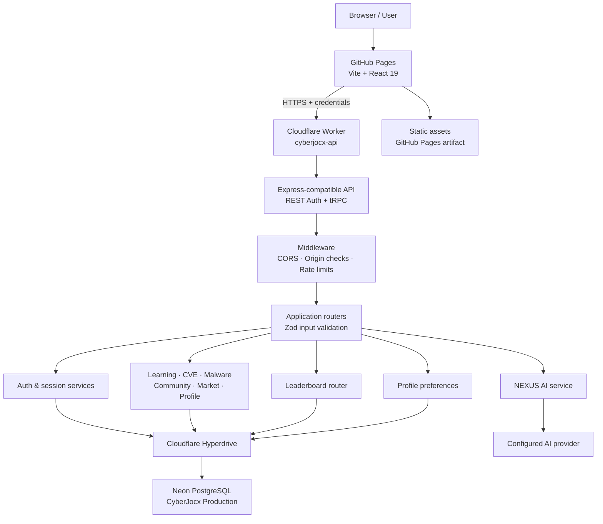
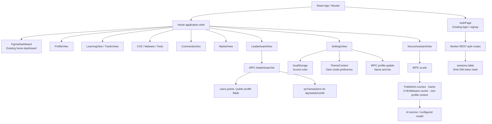

# CyberJocx Architecture

Last reviewed: 2026-11-03

## Production topology

The production application is split into a static frontend, an API Worker, and a managed PostgreSQL database.

### Frontend routes and feature connections

## Request and data flows

### Authentication

1. The browser submits login, registration, password recovery, or OAuth requests to the Cloudflare Worker.
2. The API validates input, applies rate limiting and origin checks, and reads/writes the Neon user records.
3. Session tokens are generated with cryptographically secure randomness. The database stores a SHA-256 hash rather than the raw token.
4. The response establishes the session using the configured cookie/session mechanism. Protected tRPC procedures resolve the current user before accessing private data.

### Leaderboard

- All-time order uses the persisted `users.points` value.
- Today, this week, and this month use summed `xpTransactions.amount` values within the selected UTC period.
- The endpoint returns at most 50 ranked entries and the signed-in user's own position summary.
- Only public leaderboard fields are returned: display name, avatar URL, member rank, points and rank. Email, password hashes and session data are never selected.

### Settings

- Display name and bio are saved using the existing protected `profile.update` tRPC mutation.
- Accent color is a browser preference stored in localStorage and applied through CSS custom properties.
- The UI keeps unimplemented security, notification delivery, billing, connected-account management, and account deletion actions behind the shared Coming Soon modal.
- Light and automatic themes remain Coming Soon because the current application shell is intentionally dark-themed; a partial light-mode toggle would be misleading.

### NEXUS AI assistant

- The UI sends a message and the recent conversation history to the existing protected `ai.ask` mutation.
- The server composes context from published courses, learning tracks, malware records, CVE counts and the current user's own learning context.
- The AI service calls the configured provider. Provider credentials stay on the server/Worker and are not bundled into the browser.
- Chat attachments and persistent conversation history are not enabled; those controls show Coming Soon.

## Security boundaries

- Secrets and database connection details belong only in Cloudflare Worker secret bindings and Hyperdrive configuration. Never expose them as `VITE_*` values.
- The leaderboard selects only public profile fields; it does not expose email addresses or authentication data.
- Profile updates and AI requests require an authenticated session.
- User-generated text is rendered as React text/Markdown content, not injected as raw HTML.
- Uploads and any production database migration must be reviewed separately; this UI integration does not modify the database schema.

## Deployment and validation

- Frontend: GitHub Pages, built with `pnpm build:client` and deployed by `.github/workflows/deploy-pages.yml`.
- API: Cloudflare Worker `cyberjocx-api`.
- Database: Neon PostgreSQL through Cloudflare Hyperdrive.
- CI for the integration branch runs `pnpm typecheck`, `pnpm test`, and the Docker build workflow. GitHub Pages deployment remains restricted to `main`.
- See [docs/DEPLOYMENT_ARCHITECTURE.md](docs/DEPLOYMENT_ARCHITECTURE.md) for production operations and the scheduled NVD sync.

## UI integration scope

The existing login/authentication page and main home dashboard layout were retained. The integration adds the Leaderboard, Settings, and NEXUS Assistant screens inside the existing application shell and routes. Unimplemented actions use the shared Coming Soon modal instead of inert or fake-success controls.
