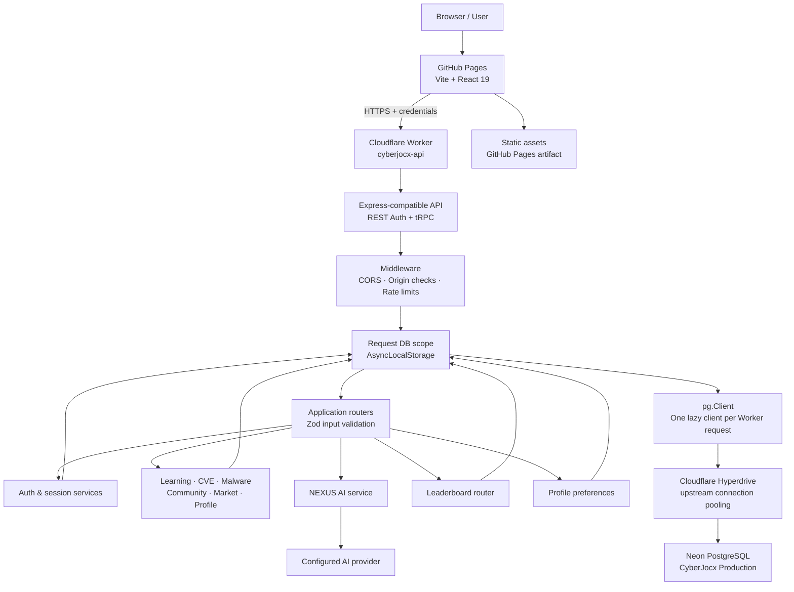
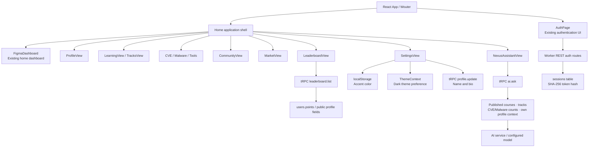

# CyberJocx Architecture

Last reviewed: 2026-11-04

## Production topology

## Frontend component map

## Database connection lifecycle

- Cloudflare sets `DB_REQUEST_SCOPED=true`. The Express middleware creates a per-request database scope backed by Node's `AsyncLocalStorage`; database access outside that scope fails closed rather than falling back to a module-global pool.
- The scope opens one `pg.Client` lazily when the first route actually queries Neon. Routes that do not touch the database do not create a PostgreSQL connection.
- The client is available only to asynchronous work created within that request's scope and is closed when the Express response finishes or closes. Concurrent Worker requests never share a `pg.Client` or `pg.Pool`.
- Hyperdrive remains responsible for pooling upstream database connections. The Worker does not maintain its own long-lived PostgreSQL pool.
- Conventional Node.js deployments keep the existing process-level `pg.Pool` fallback; the request-scoped path is enabled only by the Cloudflare Worker adapter.
- The Worker adapter source is checked in at [server/cloudflare-worker.ts](server/cloudflare-worker.ts). Build it with `pnpm build:cloudflare-worker`; its checked-in source now sets the request-scoped database mode explicitly.

## Request and data flows

### Authentication

1. Browser login, registration, password recovery and OAuth requests are sent to the Cloudflare Worker.
2. API routes validate inputs, apply rate limits and origin checks, then read/write Neon user records.
3. Opaque session tokens are generated with cryptographically secure randomness. The database stores a SHA-256 token hash rather than the raw token.
4. Protected tRPC procedures resolve the current user before accessing private data.

### Leaderboard

- All-time order uses the persisted `users.points` value.
- Today, this week and this month are visible design options but open Coming Soon; the active Worker API currently exposes the all-time query only.
- The endpoint returns up to 50 ranked entries plus a signed-in user's own position summary.
- Only public profile fields are selected: display name, avatar URL, member rank, points and rank. Email, password hashes and session data are not returned.

### Settings

- Display name and bio are saved through the existing protected `profile.update` tRPC mutation.
- Accent color is stored in browser localStorage and applied through CSS custom properties.
- Security activity, 2FA, notification delivery, billing, connected-account management and account deletion remain behind the shared Coming Soon modal because no corresponding backend workflow is currently exposed.
- Light and automatic themes remain Coming Soon; the current application shell is intentionally dark-themed.

### NEXUS Assistant

- The UI sends a message and recent conversation history to the existing protected `ai.ask` mutation.
- The server composes context from published courses, tracks, malware records, CVE counts and the current user's own learning context.
- The AI service calls the configured server-side provider. Provider credentials are not bundled into the browser.
- Attachments and persistent chat history are not enabled; their controls show Coming Soon.

## Security boundaries

- Cloudflare secrets and database credentials stay in Worker secret bindings and Hyperdrive configuration. They must never be exposed as `VITE_*` values.
- Leaderboard queries select only public profile fields.
- Profile updates and NEXUS requests require an authenticated session.
- User content is rendered as React text/Markdown rather than injected as raw HTML.
- These UI additions do not change the database schema or apply migrations.

## Deployment and validation

- Frontend: GitHub Pages, built with `pnpm build:client` and published by `.github/workflows/deploy-pages.yml`.
- API: Cloudflare Worker `cyberjocx-api`.
- Database: Neon PostgreSQL through Cloudflare Hyperdrive.
- CI: `pnpm typecheck`, `pnpm test`, and the Docker build run on the Figma integration branch. GitHub Pages deployment remains restricted to `main`.
- See [docs/DEPLOYMENT_ARCHITECTURE.md](docs/DEPLOYMENT_ARCHITECTURE.md) for OAuth, NVD scheduler and operational details.

## UI integration scope

The existing authentication screen and main home dashboard layout are retained. The integration adds Leaderboard, Settings and NEXUS Assistant screens inside the existing application shell and navigation. Unimplemented actions use a shared Coming Soon modal rather than inert or fake-success controls.

## Detailed domain architecture reference

The earlier architecture document contained a much more extensive module-by-module design and product lifecycle reference. It is preserved at [docs/ARCHITECTURE_LEGACY_REFERENCE.md](docs/ARCHITECTURE_LEGACY_REFERENCE.md) for historical domain context. Its Render/MySQL deployment model is retired; the production topology above is authoritative.
